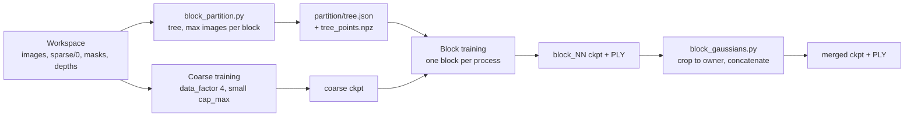

# Block training (design)

Status: implemented, not yet run end to end. Background: the
[large-scale 3DGS survey](https://github.com/MapMindAI/EasyGaussianSplatting/wiki/Paper-Survey---Large-Scale-3D-Gaussian-Splatting).

A single gsplat run holds every Gaussian, its gradient, and two Adam moments on
the GPU, about 1 KB per Gaussian at SH degree 3. The 10M cap in
`gsplat_train_drone.proto.txt` therefore needs about 10 GB before rasterization
buffers. Block training bounds the peak at one block, following CityGaussian
for the training and keeping StitchGS's overlap candidates for a later merge.

## Scope

1. **Coarse:** train the full scene once at reduced resolution and Gaussian count.
2. **Blocks:** partition the coarse model, then fine-tune each block on its own,
   one process at a time.
3. **Merge:** crop each block to the Gaussians it owns and concatenate (CityGaussian).

```bash
docker run --rm --gpus all -v "$PWD":/workspace -w /workspace ghcr.io/mapmindai/gaussiansplatting:latest \
  bash -lc 'scripts/gsplat_train_blocks.sh <workspace> [max_images] [coarse.proto.txt] [block.proto.txt] [output_dir]'
```

Results go to `<workspace>/block_training_<YYYYmmdd_HHMMSS>/{partition,coarse,blocks/block_NN,merged}`.
A stage whose output exists is skipped, so passing an earlier run's folder as
`output_dir` resumes it at the first unfinished block.

Next step, not in this design: StitchGS's overlap stitching (SIS) and global
appearance refinement with frozen geometry (GCR). Stage 2 keeps every block's
expanded-region Gaussians so SIS can replace the stage-3 crop. LoD is out of
scope.



## Coordinate frames

The mapping pipeline levels the map so gravity is -Z; blocks are therefore
columns over an XY grid with unbounded Z.

gsplat's parser normalizes the world by a similarity computed from the whole
COLMAP model (`mapping/gsplat_world_frame.py`). Every block is trained with the
**full** sparse model as its parser input and only restricts which images it
samples, so the coarse run, every block, and the merge share one normalized
frame. Checkpoints can then be cropped and concatenated without any transform,
and the merged checkpoint evaluates with `simple_trainer --ckpt` unchanged.
Ownership is decided in the COLMAP frame, where Z is up: each block run saves
the parser's COLMAP-to-normalized similarity as `scene_transform.npy`.

## Stage 1: coarse model

The existing trainer with `gsplat_server/config/gsplat_train_coarse.proto.txt`,
the drone settings except:

| Field | Value | Why |
| --- | --- | --- |
| `data_factor` | 4 | Coarse geometry needs little resolution; image buffers shrink 16x. |
| `cap_max` | 1,000,000 | Sized to fit the smallest target GPU. |
| `iterations` | 30,000 | A prior, not a deliverable. |

`test_every` must match the block configuration, so held-out images stay held
out throughout.

## Stage 2a: partition (`mapping/block_partition.py`)

Implemented over the sparse model, so it runs before any coarse model exists:
SfM points stand in for the coarse Gaussians, and cube-face images are the
unit of camera assignment.

```bash
python3 -m mapping.block_partition <workspace>/sparse/0 <output_dir> --method tree --max-images 4000
```

Every method gives each point an owning block:

* **grid:** split X into column slabs at point-count quantiles, then each
  slab's Y into rows, so blocks hold similar counts, not similar areas. Outer
  cells are unbounded.
* **tree:** recursive median split along the wider horizontal axis, the
  Hierarchical 3DGS split kept to one layer of leaves. `--blocks` fixes the
  count; `--max-images` instead keeps splitting the leaf training the most
  images until every leaf trains at most that many, so the block count follows
  how densely the scene is viewed.
* **graph:** recursive spectral (Shi-Malik) bisection of the rig-frame
  covisibility graph, edges weighted by shared points; each point goes to the
  block most of its observing frames belong to.

**Image assignment.** An image trains every block whose points cover at least
`--visibility` (default 0.1) of it, and the block covering most of it; an image
no point reaches trains none. Coverage is geometric: a 20k-point sample is
projected into every image and binned on a 32 x 32 grid, ignoring occlusion.
SfM tracks would undercount it, since a drone image shares tracks with only
its ~10 nearest frames, while distant orbits clearly see the same block.
Whole panoramas cannot be the unit either: from 20–40 m above a 200 m site,
every block covers a few percent of every panorama. This replaces the expanded
bounds and CityGaussian's contribution test.

The command writes `covisibility.png` (frame-pair map and matrix),
`comparison.png` (every method's top view side by side), and per method
`<method>.png`, `<method>.json` (metrics plus each block's `main_images` and
`training_images`), and `<method>_points.npz` (the SfM points and their owners).

Metrics: `cut_fraction` is the share of covisibility between frames whose main
blocks differ; `duplication` is blocks trained per image; `largest_over_mean_training`
bounds the slowest block.

### Results on `data/wuxi_chongansi_complete`

1,342 frames (8,052 images) from 7 drone flights, 259k points; 815k of the
900k frame pairs share a point, since orbiting cameras all see the site center.

| Blocks | Method | Cut | Training images (max / min) | Duplication | Largest / mean |
| ---: | --- | ---: | --- | ---: | ---: |
| 4 | grid, tree (identical) | 0.274 | 3,840 / 3,019 | 1.71 | 1.11 |
| 4 | graph | 0.284 | 5,969 / 3,655 | 2.47 | 1.20 |
| 8 | grid | 0.489 | 2,904 / 1,589 | 2.27 | 1.27 |
| 8 | tree | 0.490 | 2,799 / 1,548 | 2.22 | 1.25 |
| 8 | graph | 0.502 | 4,705 / 1,845 | 3.46 | 1.35 |

Graph blocks own interleaved points, since covisibility groups viewpoints (an
orbit arc), not places, so every image sees several of them. Tree is the
working choice.

Tree with `--max-images`:

| `--max-images` | Blocks | Training images (max / mean / min) | Duplication |
| ---: | ---: | --- | ---: |
| 4,000 | 4 | 3,840 / 3,449 / 3,019 | 1.71 |
| 3,000 | 7 | 3,061 / 2,444 / 1,566 | 2.12 |
| 2,000 | 14 | 1,871 / 1,503 / 1,166 | 2.61 |
| 1,500 | 18 | 1,792 / 1,133 / 289 | 2.53 |
| 1,000 | 31 | 1,104 / 596 / 38 | 2.29 |
| 750 | 36 | 953 / 466 / 74 | 2.08 |
| 500 | 49 | 718 / 286 / 59 | 1.74 |

Below 2,000 the limit is no longer met: the temple-center blocks reach the
2,000-point floor on leaf size while every orbit still sees them, and the
images they cover most add to the count. Edge blocks shrink to a few dozen
images. The block count therefore cannot be pushed much below about 1,000–2,000
images per block on this capture without splitting the densely viewed center
into slivers.

Chosen for now: `--max-images 4000`, 4 blocks of 3,019–3,840 training images,
each trained with 6M Gaussians.

## Stage 2b: block training

`mapping/train_gsplat_with_masks.py --block <manifest.json>:<name>
--coarse_checkpoint <ckpt>` with `gsplat_train_block.proto.txt` (drone
settings, `cap_max` 6M). Patches, like the existing mask and depth ones:

* **Images.** `Dataset.__init__` keeps only the block's `training_images`. The
  train/test split is still taken over the full model's indices.
* **Ownership.** A Gaussian belongs to the block owning the SfM point nearest
  it in XY (`mapping/block_gaussians.py`).
* **Initialization.** The trainable splats are the coarse Gaussians the block
  owns or that lie within 10% of its extent of its points; their opacities,
  scales, and colors carry over. Swapped in by wrapping
  `create_splats_with_optimizers`, reached through the globals of
  simple_trainer's `main`.
* **Context.** Every other coarse Gaussian is appended to each render, frozen:
  no gradient, no optimizer state, unseen by the strategy. Without it, a
  block's images show content the block cannot represent, and it grows
  floaters to explain it. MCMC only: it reads nothing per Gaussian from the
  render, whereas DefaultStrategy's densification would see the context.
* **Budget.** `cap_max` counts trainable Gaussians only.

## Stage 3: merge (`mapping/block_gaussians.py`)

Keep each block's Gaussians it owns by the same nearest-point rule and
concatenate the checkpoints' `splats` into `merged/ckpts/ckpt_merged.pt`
(evaluates with `simple_trainer --ckpt`) and `merged/ply/point_cloud_merged.ply`
in the COLMAP frame. `merged/ply/` also holds each block's own Gaussians as
`block_NN.ply` and the coarse model split by the same rule as
`coarse_block_NN.ply`, to compare a block with the context it started from.
Block checkpoints keep their expanded region for SIS.

## Evaluation

On `data/wixi_chongansi`, compare against run 13 of the
[drone benchmark](https://github.com/MapMindAI/EasyGaussianSplatting/wiki/Benchmark---Wixi-Chongansi-Drone-Scene):

* PSNR, SSIM, and LPIPS of the merged checkpoint on the shared test split
  (`simple_trainer --ckpt`).
* Peak GPU memory of each stage.
* Seams: renders of test views that straddle a block boundary.

## Tests

* `block_partition_test.py`: balanced splits, covisibility, graph bisection,
  point ownership, image coverage, and the image-limited tree.
* `block_gaussians_test.py`: nearest-point ownership, the expanded region, the
  frame inverse, and checkpoint lookup.
* The trainer patches need a GPU and are untested.

## Risks

* **Coarse stage memory.** It still holds the whole scene. If 1M Gaussians at
  `data_factor` 4 does not fit, lower `sh_degree` for this stage only.
* **Appearance jumps** between blocks trained on different image subsets. That
  is what GCR addresses in the next step.
* **MCMC relocation** can move Gaussians outside the block. They are dropped
  at merge, which wastes budget but does not corrupt the result.
* **Single GPU.** The patches are applied in-process; a multi-GPU launch would
  not carry them into its workers.
