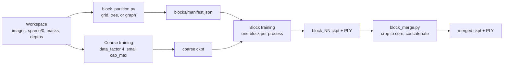

# Block training (design)

Status: design, not implemented. Background: the
[large-scale 3DGS survey](https://github.com/MapMindAI/EasyGaussianSplatting/wiki/Paper-Survey---Large-Scale-3D-Gaussian-Splatting).

A single gsplat run holds every Gaussian, its gradient, and two Adam moments on
the GPU, about 1 KB per Gaussian at SH degree 3. The 10M cap in
`gsplat_train_drone.proto.txt` therefore needs about 10 GB before rasterization
buffers. Block training bounds the peak at one block, following CityGaussian
for the training and keeping StitchGS's overlap candidates for a later merge.

## Scope

1. **Coarse:** train the full scene once at reduced resolution and Gaussian count.
2. **Blocks:** partition the coarse model, then fine-tune each block on its own,
   one process at a time.
3. **Merge:** crop each block to the cells it owns and concatenate (CityGaussian).

Next step, not in this design: StitchGS's overlap stitching (SIS) and global
appearance refinement with frozen geometry (GCR). Stage 2 keeps every block's
expanded-region Gaussians so SIS can replace the stage-3 crop. LoD is out of
scope.



## Coordinate frames

The mapping pipeline levels the map so gravity is -Z; blocks are therefore
columns over an XY grid with unbounded Z.

gsplat's parser normalizes the world by a similarity computed from the whole
COLMAP model (`mapping/gsplat_world_frame.py`). Every block is trained with the
**full** sparse model as its parser input and only restricts which images it
samples, so the coarse run, every block, and the merge share one normalized
frame. Checkpoints can then be cropped and concatenated without any transform,
and the merged checkpoint evaluates with `simple_trainer --ckpt` unchanged.
Block bounds are stored in the COLMAP frame, where Z is up; the manifest keeps
the parser's COLMAP-to-normalized similarity to test membership.

## Stage 1: coarse model

The existing trainer with a new `gsplat_server/config/gsplat_train_coarse.proto.txt`
layered over the defaults:

| Field | Value | Why |
| --- | --- | --- |
| `data_factor` | 4 | Coarse geometry needs little resolution; image buffers shrink 16x. |
| `cap_max` | 1,000,000 | Sized to fit the smallest target GPU. |
| `iterations` | 30,000 | A prior, not a deliverable. |

Output: `<workspace>/block_training/coarse/ckpts/ckpt_<step>_rank0.pt`.

## Stage 2a: partition (`mapping/block_partition.py`)

Implemented over the sparse model, so it runs before any coarse model exists:
SfM points stand in for the coarse Gaussians, and rig frames (all six faces of
one panorama) are the unit of camera assignment.

```bash
docker run --rm -v "$PWD":/workspace -w /workspace ghcr.io/mapmindai/gaussiansplatting:latest \
  bash -lc 'python3 -m mapping.block_partition <workspace>/sparse/0 <workspace>/block_partition --blocks 8'
```

Every method gives each point an owning block:

* **grid:** split X into column slabs at point-count quantiles, then each
  slab's Y into rows, so blocks hold similar counts, not similar areas. Outer
  cells are unbounded.
* **tree:** recursive median split along the wider horizontal axis, the
  Hierarchical 3DGS split kept to one layer of leaves.
* **graph:** recursive spectral (Shi-Malik) bisection of the frame covisibility
  graph, edges weighted by shared points; each point goes to the block most of
  its observing frames belong to.

A frame trains every block owning at least `--coverage` (default 0.25) of the
points it observes, and always the block owning most of them; this replaces
the expanded bounds and CityGaussian's contribution test. The command writes
`covisibility.png` (frame-pair map and matrix), and per method `<method>.png`
and `<method>.json`: metrics plus each block's `main_images` and
`training_images`.

Metrics: `cut_fraction` is the share of covisibility between frames whose main
blocks differ; `duplication` is training frames summed over blocks per frame;
`largest_over_mean_training` bounds the slowest block.

### Results on `data/wuxi_chongansi_complete`

1,342 frames (8,052 images) from 7 drone flights, 259k points; 815k of the
900k frame pairs share a point, since orbiting cameras all see the site center.

| Blocks | Method | Cut | Duplication | Largest / mean |
| ---: | --- | ---: | ---: | ---: |
| 4 | grid, tree (identical) | 0.273 | 1.30 | 1.28 |
| 4 | graph | 0.328 | 1.16 | 1.15 |
| 8 | grid | 0.498 | 1.38 | 1.31 |
| 8 | tree | 0.489 | 1.47 | 1.39 |
| 8 | graph | 0.494 | 1.21 | 1.11 |

The graph split trains on the fewest and best-balanced frames, but its owned
points are spatially interleaved: covisibility groups viewpoints (an orbit
arc), not places. The crop-and-concatenate merge needs compact ownership, so
graph blocks need a spatial ownership rule before stage 3.

## Stage 2b: block training

`mapping/train_gsplat_with_masks.py` gains `--block <manifest.json>:<name>`.
Like the existing mask and depth patches, it wraps gsplat before `simple_trainer`
runs:

* **Images.** `Dataset.__init__` keeps only indices whose image name is in the
  block. The train/test split is still taken over the full model, so held-out
  images stay held out in every block.
* **Initialization.** `create_splats_with_optimizers` builds the trainable
  splats from the coarse checkpoint's Gaussians inside the expanded bounds
  instead of SfM points.
* **Context.** The coarse Gaussians outside the expanded bounds are rendered
  with every view but are frozen: no gradient, no optimizer state, not seen by
  the strategy. Without them, a block's images show content the block cannot
  represent, and it grows floaters to explain it; occluders in front of the
  block would also be baked into its colors. Frozen, they cost about a quarter
  of their training memory. The rasterization patch appends them after the
  trainable Gaussians and slices per-Gaussian outputs (`radii`, `means2d`)
  back to the trainable count before the strategy reads them.
* **Budget.** `cap_max` is the per-block count; at least the block's initial
  count.

A shell driver, `scripts/gsplat_train_blocks.sh <workspace> [coarse parameters]
[block parameters] [rows] [columns]`, runs stage 1, the partition, every block
in sequence, and the merge. Each stage skips output already on disk, so an
interrupted run resumes at the next unfinished block.

## Stage 3: merge (`mapping/block_merge.py`)

For each block, keep the Gaussians whose means, mapped to the COLMAP frame,
fall in its core cell, and concatenate the checkpoints' `splats`. Core cells
tile the plane, so every position has exactly one owner. Write
`merged/ckpts/ckpt_merged.pt` and its PLY through `export_splats`, which the
existing patch returns to the COLMAP frame.

Block checkpoints are kept with their expanded-region Gaussians; SIS will read
them in place of the crop.

## Evaluation

On `data/wixi_chongansi`, compare against run 13 of the
[drone benchmark](https://github.com/MapMindAI/EasyGaussianSplatting/wiki/Benchmark---Wixi-Chongansi-Drone-Scene):

* PSNR, SSIM, and LPIPS of the merged checkpoint on the shared test split
  (`simple_trainer --ckpt`).
* Peak GPU memory of each stage.
* Seams: renders of test views that straddle a core boundary.

## Tests

* `block_partition_test.py`: balanced splits, covisibility, graph bisection,
  point ownership, and frame assignment by coverage.
* `block_merge_test.py`: every Gaussian lands in exactly one core; a 1x1 grid
  reproduces its input.
* `train_gsplat_with_masks` block patches: image filtering keeps the global
  test split; frozen context receives no gradient and is sliced out of the
  strategy's inputs.

## Risks

* **Coarse stage memory.** It still holds the whole scene. If 1M Gaussians at
  `data_factor` 4 does not fit, lower `sh_degree` for this stage only.
* **Appearance jumps** between blocks trained on different image subsets. That
  is what GCR addresses in the next step.
* **MCMC relocation** can move Gaussians outside the expanded bounds. They are
  dropped at merge, which wastes budget but does not corrupt the result.
