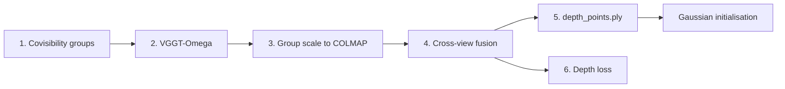

# Depth pipeline

With `run_depth` set, depth goes from the images to the loss in six steps.
[cross_view_fusion.md](cross_view_fusion.md) details step 4.

`scripts/gsplat_depth.sh` runs steps 1 to 5 (`mapping/vggt_omega/generate_depth.py`)
with the first parameters file's `depth_voxel_factor` and
`depth_min_confidence`. Step 6 runs in `mapping/train_gsplat_with_masks.py`.

## 1. Covisibility groups

`mapping/depth/covisibility_groups.py` groups 2 to 12 frames that view the
same scene. Two frames link when they share at least 20 sparse points and 20%
overlap, with a baseline of at least 0.05 map units, a rotation within 45° and
parallax between 0.5° and 25°. Anchors are taken greedily by how many
uncovered frames they reach. The `up` and `down` faces are not grouped.

## 2. Prediction

VGGT-Omega (`models/vggt_omega_416.onnx`) predicts each group together at
416 × 416, ignoring aspect ratio, so the group's depths share one scale. It
also predicts the cameras. Confidence is the model's (1 and up) times 1/5:
0.9 is a raw 4.5.

## 3. Group scale to COLMAP

`mapping/depth/scale_alignment.py` gives each group one scale:

- **Cameras:** the predicted baselines against the COLMAP ones, over pairs
  whose rotation and direction agree within 5°.
- **Sparse points:** the COLMAP points the group observes (depth at most 20),
  each frame weighted equally. It starts at the median log ratio, keeps
  samples within a MAD band, and refines by Huber reweighting, with the camera
  scale as one more term.

A group with neither is skipped. Depth discontinuities (log-depth gradient
above 0.15) are zeroed. An image in several groups keeps the prediction with
the lowest sparse error. Images with no depth, including every `up` and
`down` face, get empty files.

Each `depths/<image>.npz` holds `depth` (float16, COLMAP frame), `confidence`
(uint8 steps of 0.05, saturating at 12.75) and the group's `scale`.

## 4. Cross-view fusion

`mapping/depth/cross_view_fusion.py` checks each frame's confident pixels
against its 8 most covisible neighbours. A pixel in free space a neighbour saw
through is zeroed; the rest are averaged with the neighbours that agree.
Confidence is stored unchanged. `depths/fusion.json` marks the maps fused.

## 5. Point cloud

`mapping/depth/point_cloud.py` filters each map with `supervised_depth`
(below), lifts each kept pixel through its camera and averages per voxel, at
`depth_voxel_factor` of the scene scale (the largest camera distance from
their mean). The result is `depth_points.ply`; `depth_points.json` records
its settings, and a change rebuilds it.

Training seeds the Gaussians from the sparse SfM points plus this cloud. Under
MCMC the depth points are randomly thinned so the total stays within 80% of
`cap_max`, leaving room to relocate.

## 6. Depth loss

With `depth_lambda_begin` > 0, each training image's map is filtered by
`supervised_depth` (`mapping/depth/depth_maps.py`), which keeps a pixel when:

- its confidence is at least `depth_min_confidence`;
- its depth is within 0.1 to 5.0 model units (`depth / scale`);
- the training mask keeps it (people, sky).

Each kept map pixel becomes one sample at its centre in the training image.
gsplat renders expected depth, samples it there, and adds
`weight · scene_scale · mean |1/D_render − 1/D|`, the weight being
`depth_lambda_begin`. A positive
`depth_lambda_final` decreases `depth_lambda_begin` linearly to it at
`refine_stop_iter`, then holds it (HY-World: 0.2 to 0.01). Samples where the
render is below 0.001 of the scene scale are skipped: nothing covers them yet.

## Results

The [depth weight sweep](https://github.com/MapMindAI/EasyGaussianSplatting/wiki/Benchmark---Depth-Weight-Sweep)
sets `depth_lambda_begin` to 0.003; from 0.01 up the depth term costs PSNR.
